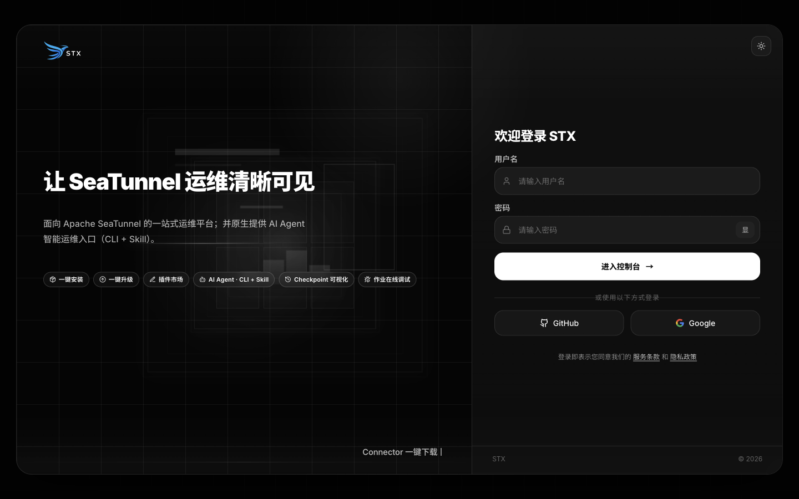

## 快速开始

在 Linux **STX 安装机** 上执行以下两步即可完成部署（默认安装到 `/opt/stx`，自带 Web UI、STX Server、内置监控与 gRPC 服务）。

### 1. 一键安装

```bash
# 中国网络（推荐）
curl -fsSL https://v4.gh-proxy.org/https://github.com/LeonYoah/stx/releases/latest/download/install-online.sh | sudo bash

# 直接访问 GitHub
curl -fsSL https://github.com/LeonYoah/stx/releases/latest/download/install-online.sh | sudo bash
```

不加 `-y` 时会交互询问端口、对外 IP、数据库和管理员密码，直接回车即使用默认值。检查运行状态：

```bash
/opt/stx/bin/status.sh
# systemd 安装也可用：systemctl status stx
```

### 2. 登录 Web UI

打开 `http://<STX 安装机 IP>:17880`（例如 `http://10.0.0.10:17880`），用 `admin` 与安装时设置的密码登录（默认 `admin123`，登录后请及时修改）。



| 服务 | 默认端口 | 需要放行给谁 |
| :--- | :--- | :--- |
| Web UI | `17880` | 浏览器访问 |
| STX Server HTTP API | `17800` | Web UI、CLI、被纳管主机安装脚本 |
| stx-agent gRPC | `17890` | 被纳管主机上的 `stx-agent` |

登录后前往[主机管理](../host-cluster/host-management)接入机器，再到[集群管理](../host-cluster/cluster-management)创建或纳管 SeaTunnel 集群。

---

## 特殊场景部署

### 离线安装

在联网机器按目标机架构与 glibc 下载对应离线包及 `.sha256` 文件（含 STX Server、Web UI、stx-agent 与 Node）：

| 离线包 | 适用系统 | 判断方式 |
| :--- | :--- | :--- |
| `stx-offline-linux-amd64.tar.gz` | x86_64，glibc ≥ 2.28（Ubuntu 20.04+ / Debian 10+ / RHEL 8+） | `uname -m` 为 `x86_64`，`ldd --version` ≥ 2.28 |
| `stx-offline-linux-arm64.tar.gz` | aarch64，glibc ≥ 2.28 | `uname -m` 为 `aarch64` |
| `stx-offline-linux-amd64-centos7.tar.gz` | x86_64，glibc < 2.28（CentOS 7 / RHEL 7） | `ldd --version` 为 2.17 等 |

```bash
# 联网机下载（示例为 CentOS 7；可替换为上表任意包名或改用其他下载线路）
F=stx-offline-linux-amd64-centos7.tar.gz
U=https://github.com/LeonYoah/stx/releases/latest/download/$F
wget "https://v4.gh-proxy.org/$U"
wget "https://v4.gh-proxy.org/$U.sha256"
```

也可自动测速下载：`curl -fsSL https://v4.gh-proxy.org/https://github.com/LeonYoah/stx/releases/latest/download/download-bundle.sh | bash -s -- --variant centos7`。

拷到无网机器后校验并安装：

```bash
sha256sum -c stx-offline-linux-amd64-centos7.tar.gz.sha256
tar -xzf stx-offline-linux-amd64-centos7.tar.gz
cd stx-*-offline/
sudo ./install.sh
```

`./install.sh` 支持下方所有通用安装参数（默认从当前离线包安装，无需额外加 `--offline`）。离线部署 SeaTunnel 集群还需另备 [SeaTunnel 离线资产包](../packages-plugins/package-management#离线导出资产包)。

### Docker Compose

```bash
mkdir -p stx-docker && cd stx-docker
# 中国网络；直连 GitHub 去掉 https://v4.gh-proxy.org/ 前缀
curl -fsSL https://v4.gh-proxy.org/https://github.com/LeonYoah/stx/releases/latest/download/stx-docker-compose.tar.gz | tar -xz
cd docker && mkdir -p data
# 如需华为云 SWR 镜像源，先执行：cp .env.cn.example .env
# 若被纳管主机不在本机，请将 config.yaml 中的 app.external_url / app.console_url 改为可达 IP
```

| 数据库 | 启动命令 |
| :--- | :--- |
| MySQL（默认） | `docker compose up -d` |
| SQLite | `docker compose -f docker-compose.sqlite.yml up -d` |
| PostgreSQL | `docker compose -f docker-compose.postgres.yml up -d` |

宿主机暴露 `17880` / `17800` / `17890`，内置监控数据位于挂载目录 `data/stx/tsdb`。从旧版升级时执行 `docker compose up -d --remove-orphans` 清理旧监控容器。

### 单容器试用

```bash
# GHCR
docker run -d -p 17800:17800 -p 17880:17880 -p 17890:17890 ghcr.io/leonyoah/stx-all-in-one:latest

# 华为云 SWR
docker run -d -p 17800:17800 -p 17880:17880 -p 17890:17890 swr.cn-east-3.myhuaweicloud.com/stx/stx-all-in-one:latest
```

内置监控数据默认写在容器内 `/opt/stx/data/tsdb`，需要持久化请挂载该目录。

### 安装 STX CLI

STX 客户端与服务端共用同一个 `stx` 二进制：

- **与服务端同机**：直接使用 `/opt/stx/stx`，无需单独安装：

```bash
/opt/stx/stx login --server http://127.0.0.1:17800
/opt/stx/stx cluster list --output table
```

- **独立客户端机器**：架构相同时直接拷贝 `/opt/stx/stx`（不同架构请从 Release 下载对应 `stx-linux-amd64` 或 `stx-linux-arm64`），放通服务端 `17800` 即可：

```bash
scp user@10.0.0.10:/opt/stx/stx ./stx
chmod +x ./stx
./stx login --server http://10.0.0.10:17800
./stx cluster list --output table
```

CLI 用法见 [STX CLI](../architecture/cli)；给 AI Agent 接入可执行 `stx skill install`（见[安装 Skill](../architecture/cli#给-ai-agent-安装-skill)）。

### 无 systemd 或非 root 环境

容器、CI 等无 systemd 环境加 `--no-systemd`；非 root 用户同时指定可写的 `--install-dir`：

```bash
curl -fsSL https://v4.gh-proxy.org/https://github.com/LeonYoah/stx/releases/latest/download/install-online.sh \
  | bash -s -- -y --no-systemd --install-dir "$HOME/stx"
```

---

## 高级参数与常用操作

### 安装参数

参数追加在 `sudo bash -s --` 或 `sudo ./install.sh` 之后，例如 `... | sudo bash -s -- -y --install-dir /data/stx`：

| 参数 | 作用 |
| :--- | :--- |
| `-y` | 非交互安装，使用默认值或已传参数 |
| `--install-dir /opt/stx` | 安装目录，默认 `/opt/stx` |
| `--admin-password xxx` | admin 初始密码 |
| `--frontend-port` / `--http-port` / `--grpc-port` | Web UI / HTTP API / gRPC 端口，默认 `17880` / `17800` / `17890` |
| `--external-ip 10.0.0.10` | 对外访问 IP 或域名 |
| `--db-type sqlite\|mysql\|postgres` | 数据库类型，默认 `sqlite`（`postgres` 可简写 `pg`） |
| `--db-host` / `--db-port` / `--db-user` / `--db-password` / `--db-name` | 外置 MySQL / PostgreSQL 连接参数；密码也可用环境变量 `STX_DB_PASSWORD` |
| `--without-observability` | 关闭内置监控（指标采集、趋势图与指标告警） |
| `--mirror v4` | 指定下载线路（仅在线安装 / `download-bundle.sh`） |
| `--variant amd64\|arm64\|centos7` / `--version <tag>` | 指定包架构或发布标签（仅在线安装 / `download-bundle.sh`） |
| `--without-node` | 使用本机 Node ≥ 18.18，不装自带 Node |
| `--service-user stx` | 指定服务运行用户（默认 root） |
| `--no-autostart` / `--no-systemd` / `--no-start` | 不开机自启 / 不建 systemd 单元 / 装完不启动 |

外置 PostgreSQL 示例：

```bash
curl -fsSL https://v4.gh-proxy.org/https://github.com/LeonYoah/stx/releases/latest/download/install-online.sh \
  | sudo STX_DB_PASSWORD='<password>' bash -s -- -y --db-type postgres --db-host 10.0.0.5 --db-user stx --db-name stx
```

### 下载线路

一键脚本默认自动测速选最快线路，也可用 `--mirror` 固定（填编号、名称或自定义代理前缀）：

| 编号 | 名称 | 地址 |
| :--- | :--- | :--- |
| 1 | `gh-proxy` | `https://gh-proxy.org` |
| 2 | `v4` | `https://v4.gh-proxy.org`（推荐，仅 IPv4） |
| 3 | `v6` | `https://v6.gh-proxy.org`（支持 IPv6） |
| 4 | `cdn` | `https://cdn.gh-proxy.org` |
| 5 | `axisnow` | `https://axisnow.gh-proxy.org` |
| 6 | `github` | GitHub 直连 |

### 启停与监控开关

```bash
/opt/stx/bin/start.sh
/opt/stx/bin/stop.sh
/opt/stx/bin/status.sh
# systemd：systemctl restart stx
```

内置监控随 STX Server 启停；如需关闭，在 `config.yaml` 中设置 `observability.enabled: false` 后重启。

### 环境要求与排查

- **系统与架构**：Linux（glibc ≥ 2.17），`amd64` / `arm64`（CentOS 7 仅 `amd64`）；需 `bash`、`curl`、`tar`、`gzip`、`sha256sum`，无需预先安装 Node.js 或 Python。
- **磁盘**：安装分区约 700 MB 起步；内置监控数据写在 `data/tsdb`，默认按容量清理，上限 `min(30 GiB, 磁盘容量的 20%)`。

| 现象 | 排查方式 |
| :--- | :--- |
| 端口被占用 | 用 `ss -lntp \| grep -E '17800\|17880\|17890'` 查占用进程，或通过 `--http-port` 等参数改端口 |
| 安装失败 | 查看安装脚本提示的日志 `/tmp/stx-install-*.log` 或 `/opt/stx/logs/install.log` |
| 主机一直离线 | 在被纳管主机测试 STX 安装机的 `17800` 和 `17890` 连通性，检查防火墙 / 安全组 |
| 打开 `17800` 看不到登录页 | Web UI 默认端口是 **`17880`**，`17800` 为 HTTP API |
| 下载慢或失败 | 换用 `--mirror v4` 或其他[下载线路](#下载线路) |

本地源码开发见[源码仓开发说明](https://github.com/LeonYoah/stx/blob/main/README_CN.md)。
