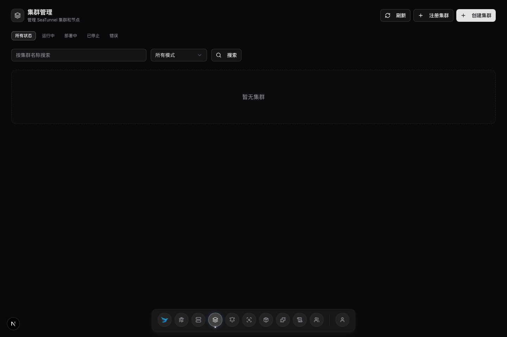

Web UI 打开 **集群管理**。列表支持按状态与部署模式筛选，并可在表格和卡片视图间切换；选中集群后可在右侧速览栏查看安装目录与节点状态，直接 **进入控制台**、停止或重启。

先[接入主机](./host-management)，确认 stx-agent 在线。已有 SeaTunnel 进程时选 **注册集群**；需要在主机上安装 SeaTunnel 时选 **创建集群**。

## 选择接入方式

| 路径 | 什么时候用 | 接下来做什么 |
| :--- | :--- | :--- |
| **纳管已有进程** | 主机上已经运行 SeaTunnel | 创建集群和节点，发现进程后绑定 |
| **一键安装** | 要在主机上安装新的 SeaTunnel 集群 | 准备安装包，选择主机和角色，预检后安装 |

## 部署模式与状态

| 概念 | 取值 / 默认 | 说明 |
| :--- | :--- | :--- |
| **部署模式** | 混合 / 分离 | 混合：Master+Worker 同进程；分离：独立 Master / Worker 进程 |
| **节点角色** | Master、Worker、Master/Worker | 混合模式常用 Master/Worker |
| **集群状态** | 已创建 → 部署中 → 运行中 / 已停止 / 异常 | 刚创建时为「已创建」 |
| **节点状态** | 待部署 / 安装中 / 运行中 / 已停止 / 异常；还可能显示离线 | 离线表示该节点所在主机的 Agent 不在线 |
| **默认端口** | Master 通信 `5801`、API `8080`、Worker 通信 `5802` | 可按节点覆盖 |

## 纳管已有进程

1. **集群管理** → **注册集群**：填写名称，选择部署模式和 SeaTunnel 版本。
2. 添加节点：指定在线主机、角色、安装目录与端口（默认可按上表）。
3. 在主机或节点操作里触发发现（Agent 扫描本机 SeaTunnel 进程）。
4. 确认绑定后，节点应显示进程 PID 与实际安装目录。

:::tip
同机多进程时，务必核对角色与端口，避免把 Worker 绑到 Master 节点记录上。
:::

## 一键安装

Web UI 的[安装包管理](../packages-plugins/package-management)中需要有目标版本的安装包。可以先上传，也可以下载；需要的连接器见[插件市场](../packages-plugins/plugin-marketplace)。

点击 **创建集群**：

1. 在 **基本信息** 填写名称，选择部署模式和版本，确认安装路径。
2. **选择主机**并分配角色。分离模式至少有一个 Master 和一个 Worker。
3. 在 **安装配置** 确认端口和资源设置。各节点的 **JDK 路径** 可分别选择探测到的 JDK、填写绝对路径（如 `/usr/lib/jvm/java-11`）或留空自动探测。

4. 在 **环境预检** 查看 stx-agent、端口、安装目录和 JDK 检查结果。安装目录可以还不存在，但最近一级已存在的父目录必须可写。指定的 JDK 无法执行时，修正路径后点 **重新检查**。

5. 按需选择 **扩展插件**，点 **开始部署**。在 **执行部署** 查看进度和各节点结果；部署成功后，在集群列表确认状态为 **运行中**。

预检按目标 SeaTunnel 版本判断 JDK。例如，SeaTunnel 2.3.13 推荐 JDK 8 或 11；SeaTunnel 3.1.0 至少需要 JDK 11，推荐 JDK 11 或 17。JDK 24 及以上无法启动 SeaTunnel，预检会直接判定失败，请改用 JDK 8 / 11 / 17 / 21。升级时按目标版本检查。

## 版本升级

集群详情打开 **升级**（也可在详情的 **升级记录** 里查看历史任务）。流程分三步：**准备升级** → **配置合并** → **执行升级**。

### 准备升级

1. 选择 **目标版本**，确认 **目标安装目录**（默认可按版本推导）。
2. 在[安装包管理](../packages-plugins/package-management)备好目标版本安装包；在[插件市场](../packages-plugins/plugin-marketplace)备好目标版本所需插件。缺包或缺插件时，界面会提示前往补齐。
3. 点 **运行预检查**，在 **目标节点清单** 确认每个节点的 **目标 JDK** 后点击 **进入配置合并页**；若改过目标版本、目录或 JDK，需 **重新运行预检查**。

升级时会切到目标版本的 connector JAR，并按本地已准备的目标版本插件增量叠加 `lib` / `plugins` 依赖；安装包自带的同名基础 JAR 会保留。

### 配置合并

页面标题为 **配置差异处理**。系统对比当前集群配置与目标版本配置；**不会自动替你决定**冲突行该用哪一边。

| 区域 | 作用 |
| :--- | :--- |
| **配置文件列表** | 按文件切换；有差异的文件带数量标记，无差异会标明 |
| **旧版本配置** | 当前集群生效的内容；可 **整份采用旧版本** |
| **最终合并结果** | 将下发的最终配置；可直接编辑 |
| **新版本配置** | 目标版本提供的内容；可 **整份采用新版本** |

有冲突的行可点 **采用旧值** / **采用新值**。全部差异处理完后，才能 **生成升级计划**。

部分文件若两边无真实冲突，系统可能自动合并并提示原因；仍需你确认整体结果。只要还有 **待选择** / **需要明确选择** 的项，就不能生成计划。

### 执行升级

生成计划后核对版本、安装包、节点目标与步骤，再 **启动升级执行**。执行页可看：

| 面板 | 说明 |
| :--- | :--- |
| **完成比例** | 当前任务整体进度 |
| **执行详情** | **步骤树** 或 **节点执行状态** |
| **日志面板** | 按步骤、级别、节点过滤持久化日志 |

常见收尾步骤包括健康检查、可用性验证与完成。任务结束后可在集群详情的 **升级记录** 再次打开执行详情；也可基于同一计划 **重新执行**（会新建任务，旧任务日志保留）。

:::tip 升级前
对关键同步作业先做 Savepoint 或暂停，再启动升级，便于失败或回退后恢复位点。
:::

## 日常运维

点击集群进入详情页，顶部提供 **总览**、**节点**、**配置**、**插件**、**运行时**、**运维** 六个页签：

在集群详情 / 节点列表可对 **整集群** 或 **单节点** 做：

| 操作 | 说明 |
| :--- | :--- |
| **启动 / 停止 / 重启** | 经 stx-agent 下发 |
| **查看日志** | 拉取节点侧引擎日志，便于排启停与作业异常 |
| **加节点** | 支持单台添加与同机批量添加；添加前可预检 |
| **删节点 / 删集群** | 先查看正在运行的作业；主机仍关联集群节点时，不能从主机管理删除 |
| **升级** | 见上文「版本升级」 |

:::tip 停集群前
对关键同步作业先做 Savepoint 或暂停，再执行停止 / 滚动重启，保留恢复位置。
:::

## 和主机管理的边界

- **主机**：机器 + stx-agent 是否连通、资源心跳
- **集群**：SeaTunnel 拓扑与进程生命周期
- 节点是否可操作，同时取决于节点状态与主机是否在线
