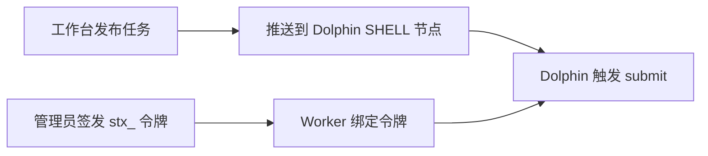

工作台可以把已发布任务推到 Apache DolphinScheduler：工作流里会出现一个 SHELL 节点，触发时在 Worker 上执行 `stx sync task submit`。推送只写这个节点，不签发、不写入 Worker 的登录令牌。

内置 **定时** 仍是单机轻量周期触发。复杂依赖和统一告警放在 DolphinScheduler 工作流里编排；STX 负责脚本版本和提交。

## 打开外部调度

Web UI 底栏打开 **工作台**，打开要调度的任务，右侧切到 **定时**：


右侧先是 cron 与 **定时预览**，下面是 **外部调度**。未绑定时提示：可复制 SHELL 脚本手工建节点，或推送到 DolphinScheduler。

| 状态 | 界面 |
| :--- | :--- |
| 未绑定 | 提示：可复制 SHELL 脚本手工建节点，或推送到 DolphinScheduler |
| 已绑定 | 显示工作流 / 节点编号，以及「已发布 vN · 已推送 vM」 |
| 已绑定后 | 内置定时保持关闭，文案是「任务已绑定 Dolphin，内置定时保持关闭」 |

内置定时和外部调度都只跑**已发布版本**。未发布改动不会被调度。

## 先发布

还没发布时，界面提示「请先发布任务后再推送到 Dolphin」。**预演** 和 **确认推送** 不可用。

发布后才能 **推送到 Dolphin**。同一发布版本不能再更新推送；界面会提示「已推送 vN，请先发布新版本再更新节点」。

## 复制脚本或推送

| 按钮 | 作用 |
| :--- | :--- |
| **复制节点脚本** | 复制 SHELL 正文和 Worker 提醒，去 Dolphin 里手工建节点 |
| **推送到 Dolphin** | 打开推送弹窗，由 STX 写入 DolphinScheduler 工作流 |
| **更新节点** | 已绑定后出现，覆盖该 SHELL 节点脚本，不改连线 |
| **打开 Dolphin** | 已绑定且有控制台地址时，打开 Dolphin 页面 |
| **解除绑定** | 只删 STX 侧绑定，不改 DolphinScheduler 里的工作流，也不吊销登录令牌 |

复制出的脚本会提交当前任务，并带上 Dolphin 的实例、节点占位符，例如：

```bash
exec stx sync task submit 12 --wait --confirm \
  --external-ref "ds:${system.workflow.instance.id}:${system.task.definition.code}" \
  --schedule-time "${system.datetime}"
```

实时任务会写成 `--wait --close-job=false --confirm`，避免 CLI 退出时把流作业停掉。脚本不写入 `--timeout`；作业跑多久由引擎终态和 Dolphin 节点超时决定。Worker 组默认 **default**。

附带的提醒是：Worker 环境（默认名 `stx-cli-prod`）要由你自己绑定 STX 登录令牌；推送不会写入 `STX_TOKEN`。

## 保存调度器连接

点 **推送到 Dolphin** 后，若还没有连接，先填 Open API 地址和 Token，才能列出项目。

| 字段 | 说明 |
| :--- | :--- |
| **连接名称** | 本机好认的名字，例如 `dolphin-prod` |
| **Open API 地址** | 例如 `http://10.0.0.30:12345/dolphinscheduler`。这是 Dolphin Worker / API 机能访问的地址，不是 STX Web UI |
| **Dolphin Open API Token** | 必填，走请求头 `token`。**不是** Worker 环境里的 `STX_TOKEN` |
| **Dolphin 版本** | 可空，自动探测。只支持 3.x：3.0 / 3.1 / 3.2 走 `process-definition`，3.3+ 走 `workflow-definition` |

保存后 Token 脱敏显示「Open API Token 已保存（脱敏）」。选好 **调度器连接** 和 **项目**，再选新建或复用工作流。


## 新建或复用工作流

| 模式 | 做什么 |
| :--- | :--- |
| **新建工作流** | 填写 **工作流名称**；可选 **沿用 STX 内置定时**，把当前 cron 抄到新工作流 |
| **复用已有工作流** | 选择工作流，再选 **上游节点** / **下游节点** |

所选上下游会成环时，界面提示「所选上下游会成环，无法推送」，不会写入 Dolphin。

已绑定后再推：只覆盖该 SHELL 节点脚本，不改连线。弹窗里可对照 **Dolphin 当前脚本** 和 **即将写入的脚本**。

建议先点 **预演**（通过则「预演通过，未写入 Dolphin」），再 **确认推送**。

## Worker 登录令牌

推送不负责绑定登录令牌。Dolphin Worker 要能访问 STX 安装机 API（默认 **17800**）。

STX 客户端和服务端是同一个二进制文件，把它复制到 Worker 机器即可用 CLI 能力，不需要在那台机器上启动 STX Server。安装方式见[快速部署 → 安装 STX CLI](../get-started/quick-start#安装-stx-cli)。

举例：STX 在 `10.0.0.10`，Dolphin Worker 在 `10.0.0.30`。管理员先在 `10.0.0.10` 签发令牌，再到 Worker 上绑定：

```bash
stx login --server http://10.0.0.10:17800 --token stx_...
```

或在 Worker 环境里设置 `STX_SERVER`、`STX_TOKEN`。签发步骤见 [令牌管理](../architecture/token-management)。



## 命令行

```bash
# 预演 / 推送（要 --confirm）
stx sync task dolphin push 12 --dry-run --confirm
stx sync task dolphin push 12 --new-workflow --workflow-name stx-orders --confirm

# 保存 Dolphin 连接
stx sync scheduler connection create --name dolphin-prod \
  --base-url http://10.0.0.30:12345/dolphinscheduler \
  --token <dolphin-open-api-token> --confirm
```

Dolphin 触发后，作业会带上 `ds:` 引用。底部任务列表的 **模式** 会显示 **Dolphin 调度**，和手动运行、内置定时分开：


按引用停作业：

```bash
stx sync job cancel-by-ref --external-ref 'ds:123:456' --confirm
```

工作台里写脚本、发布和内置定时见 [调试工作台](./overview)。
