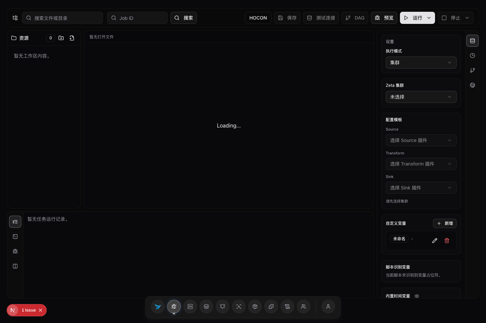
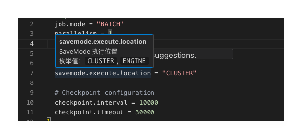
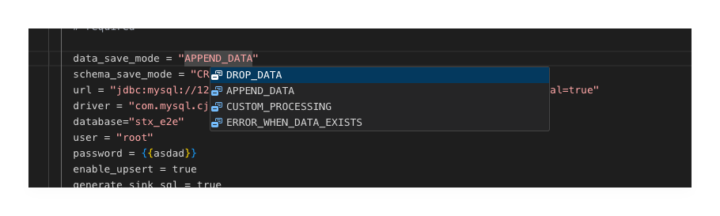
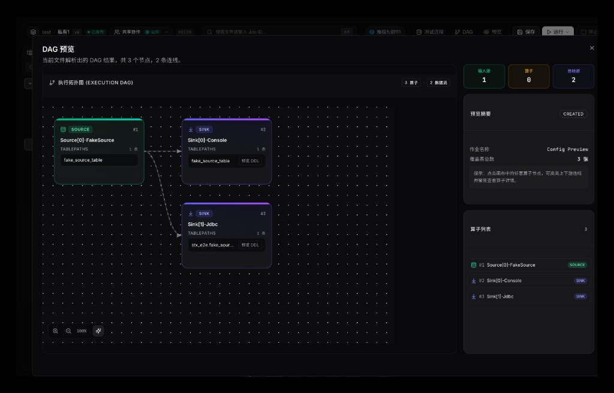
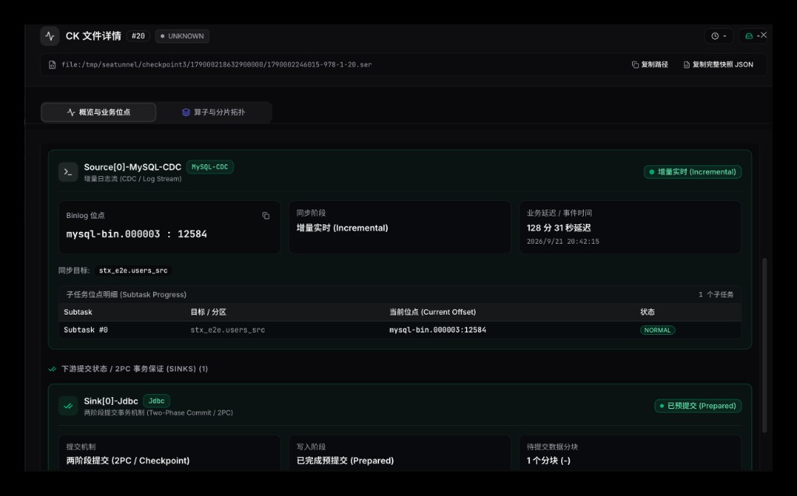

Web UI 底栏打开 **工作台**。选择集群，再新建任务或打开已有任务。你可以用当前草稿调试和手动运行；启用内置定时或推送到 DolphinScheduler 前需要发布版本。

## 打开工作台



## 使用模板

选择集群后，打开右侧 **模板**。这里有两个页签：

| 页签 | 用法 |
| :--- | :--- |
| **精选模板** | 默认打开。按 `env`、`source`、`transform`、`sink` 或组合筛选，点选模板先看预览，再点 **插入**。 |
| **原始默认参数模板** | 选择 Source、Transform 或 Sink 插件，将插件提供的 HOCON 参数模板插入编辑区。要查某个插件的全部原始参数时切到这里。 |


精选模板可按片段组合使用。点选后下方可预览 HOCON，再 **插入** 写入编辑器。插入 `env` 时，如果脚本已有 `env`，会替换原有部分；插入**组合模板**时会替换整个编辑区，非空脚本会先要求确认。插入后先检查示例地址、库表、路径和凭证变量，再保存或发布。

**模板管理**可以新建、复制、修改和删除自己的精选模板。系统模板只读；点 **复制** 后修改自己的副本。若要保存现有脚本的一段，在编辑器里选中文本，右键点 **另存为精选**，填写名称和分区后保存。密码或密钥请用 `{{变量名}}`，不要写入明文。

编辑配置时可查看：

| 能力 | 表现 |
| :--- | :--- |
| **悬停说明** | 光标停在参数名上：说明、默认值、是否必填、枚举列表 |
| **枚举补全** | 在 `=` 后弹出合法取值（如 `DROP_DATA` / `APPEND_DATA` / `CUSTOM_PROCESSING` / `ERROR_WHEN_DATA_EXISTS`） |

说明和枚举值来自所选集群的连接器包。使用这些能力时，需要选中具体集群；节点上的 `stx-java-proxy` 默认监听 **18080**，STX Server 需要能访问它。





## 调试脚本

写完配置后，先用当前脚本检查连接、作业结构和数据样本：

| 能力 | 解决什么 | 怎么用 |
| :--- | :--- | :--- |
| **DAG** | 脚本依赖关系看不清 | 解析 Source / Transform / Sink，画成节点与边；Sink 侧还会解析将要执行的**建表语句** |
| **测试连接** | 还不需要看拓扑，只想验证连通与对象是否存在 | 点工具栏 **测试**，查看各连接的检查结果 |
| **预览** | 想看真实数据长什么样，再写 Transform / Sink | 用当前脚本从 Source 读样本，可经 Transform，不会写入原来的 Sink |

:::tip
DAG、测试连接和预览用编辑器里的当前脚本，不必先发布。新任务要先保存一次。
:::

### DAG

看清「这条脚本在干什么」：上游从哪张表来、中间怎么变换、下游写到哪。点开算子可对表路径与字段；Sink 上能对照实际建表 DDL。



### 测试连接

修改连接地址、账号或表名后，点 **测试**，在 **测试连接** 弹窗中查看各连接的结果。不需要运行完整作业。


### 预览

点击 **预览**，确认 **返回行数**（默认 **100**）和超时（默认 **10 分钟**），然后点 **开始预览**。在底部 **预览** 页签查看 Source 或 Transform 的样本行，不会写入原来的 Sink。


[查看预览操作动图](/img/screenshots/48-workbench-preview.webp)

## 保存与发布

| 动作 | 作用 |
| :--- | :--- |
| **保存** | 只更新草稿，不生成版本。编辑已有任务后稍停，工作台会自动保存当前草稿。 |
| **发布** | 在「发布新版本」弹窗中确认后，保存当前内容并生成不可变版本，供版本追溯、定时调度和 CLI 提交使用。 |

还有未保存的更改时，从站内离开工作台会收到提示：**留下继续编辑**、**保存并离开**或**丢弃并离开**。丢弃只影响尚未保存的更改。

工作台点 **运行** 使用编辑器里的当前草稿；CLI 提交任务和内置定时使用已发布版本。工具栏 **Savepoint 恢复**使用当前草稿和选中的恢复点，且任务须至少发布过一次；从历史行点 **恢复**则优先使用该实例原先提交的配置。

## 变量管理

配置里用双花括号引用，例如 `{{mysql_password}}`、`{{system.biz.date}}`。

| 类型 | 用途 |
| :--- | :--- |
| **内置时间变量** | 平台提供的日期 / 时间表达式（如业务日），悬停可预览当前基准下的解析结果 |
| **自定义变量** | 任务级普通文本，方便把库名、路径等抽出去 |
| **密码 / 保密变量** | 保存后界面加星，不再回显明文 |
| **全局变量** | 跨任务复用的平台级变量 |

右侧 **任务变量** 可维护本任务自定义项；脚本里出现的占位会在「脚本识别变量」里汇总。变量名不要与内置时间变量冲突。

## 定时（轻量，非生产编排）

工作台带简易 **定时**（cron）。改定时配置后要点 **保存** 才会生效；**开启定时**前任务须至少有一个**已发布版本**，触发时跑的是最新已发布内容，不会用未保存草稿。

这是**单机轻量**周期触发。复杂工作流、依赖和统一告警，把已发布任务[推到 DolphinScheduler](./dolphin-scheduler)。内置定时和外部调度都只跑已发布版本。

## Checkpoint 与一键恢复

实时作业开了 Checkpoint 时，异常或正常停掉后，若只能调 HTTP 或命令行先找作业 ID、再带参数恢复，步骤长、易错。工作台提供：

- 工具栏 **Savepoint 恢复**  
- 底部任务列表行内 **恢复**（按该次历史实例）

```bash
stx sync job recover <job-id> --confirm
stx sync job cancel <job-id> --savepoint --confirm
```

引擎自带的 Checkpoint 界面信息往往偏少。STX 经 **stx-java-proxy** 做反序列化解析，打开 **CK 文件详情** 可直接看到，例如：

- MySQL CDC 等源的 **Binlog 位点**  
- 读取进度相对事件时间的 **延迟**  
- Sink 侧两阶段提交（2PC）状态  
- 触发 / 完成 / 失败次数、单次耗时波形  



底部切到 **Checkpoint** 即可进入。流作业通常要等 `checkpoint.interval` 后才有首个点；**BATCH** 默认不触发检查点。

## 从调试到运行

1. 右侧选中在线集群。  
2. 新建或打开任务 → 从 **精选模板** 插入 `MySQL-CDC` / `Jdbc` 等片段，或到 **原始默认参数模板** 选插件。
3. 用悬停与枚举补全改参数；密码放进保密变量。  
4. **测试连接** → **DAG** 核对拓扑与建表 → **预览** 看样本行（可随时 **保存**）。
5. 点 **运行**执行当前草稿；需要定时调度时再发布。流作业可在 Checkpoint 页查看位点与延迟。

新建任务默认带 `FakeSource` → `Console` 骨架，可先练编辑与预览。也可先[一键装一套集群](../host-cluster/cluster-management)做联调。集群上缺少连接器时，到[插件市场](../packages-plugins/plugin-marketplace)下载并安装。

命令行用法见 [CLI 设计](../architecture/cli)。集群接入见 [集群管理](../host-cluster/cluster-management)。
