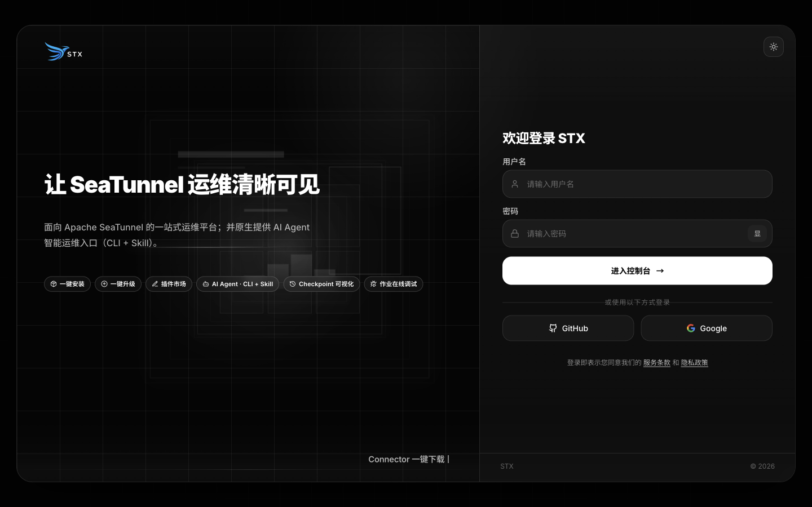

## Quick start

Run these two steps on your Linux **STX install machine** (installs to `/opt/stx` by default with Web UI, STX Server, built-in monitoring, and gRPC).

### 1. One-click install

```bash
# Direct GitHub
curl -fsSL https://github.com/LeonYoah/stx/releases/latest/download/install-online.sh | sudo bash

# China mirror (recommended in China)
curl -fsSL https://v4.gh-proxy.org/https://github.com/LeonYoah/stx/releases/latest/download/install-online.sh | sudo bash
```

Without `-y`, the script prompts for ports, external IP, database, and admin password—press Enter to accept defaults. Check status:

```bash
/opt/stx/bin/status.sh
# With systemd: systemctl status stx
```

### 2. Sign in to the Web UI

Open `http://<STX install host IP>:17880` (e.g. `http://10.0.0.10:17880`) and sign in as `admin` with your chosen password (default `admin123`; change it after first sign-in).



| Service | Default port | Required access |
| :--- | :--- | :--- |
| Web UI | `17880` | Browser access |
| STX Server HTTP API | `17800` | Web UI, CLI, and managed-host install scripts |
| stx-agent gRPC | `17890` | `stx-agent` on managed hosts |

Next, connect machines in [Host management](../host-cluster/host-management), then create or register a SeaTunnel cluster in [Cluster management](../host-cluster/cluster-management).

---

## Special deployment scenarios

### Offline install

On a machine with Internet access, download the offline bundle and its `.sha256` file for the target machine (includes STX Server, Web UI, stx-agent, and Node):

| Bundle | Target system | How to tell |
| :--- | :--- | :--- |
| `stx-offline-linux-amd64.tar.gz` | x86_64, glibc ≥ 2.28 (Ubuntu 20.04+ / Debian 10+ / RHEL 8+) | `uname -m` is `x86_64`, `ldd --version` ≥ 2.28 |
| `stx-offline-linux-arm64.tar.gz` | aarch64, glibc ≥ 2.28 | `uname -m` is `aarch64` |
| `stx-offline-linux-amd64-centos7.tar.gz` | x86_64, glibc < 2.28 (CentOS 7 / RHEL 7) | `ldd --version` shows 2.17, etc. |

```bash
# Download on a networked machine (CentOS 7 example; swap filename or mirror as needed)
F=stx-offline-linux-amd64-centos7.tar.gz
U=https://github.com/LeonYoah/stx/releases/latest/download/$F
wget "$U"
wget "$U.sha256"
```

Or use the auto-probing helper: `curl -fsSL https://v4.gh-proxy.org/https://github.com/LeonYoah/stx/releases/latest/download/download-bundle.sh | bash -s -- --variant centos7`.

Copy both files to the offline host, verify, and install:

```bash
sha256sum -c stx-offline-linux-amd64-centos7.tar.gz.sha256
tar -xzf stx-offline-linux-amd64-centos7.tar.gz
cd stx-*-offline/
sudo ./install.sh
```

`./install.sh` accepts all common flags below (installs from the local bundle by default—no extra `--offline` flag needed). To deploy SeaTunnel clusters offline as well, also prepare a [SeaTunnel offline asset bundle](../packages-plugins/package-management#offline-export-asset-bundle).

### Docker Compose

```bash
mkdir -p stx-docker && cd stx-docker
# Direct GitHub (in China, prefix URL with https://v4.gh-proxy.org/)
curl -fsSL https://github.com/LeonYoah/stx/releases/latest/download/stx-docker-compose.tar.gz | tar -xz
cd docker && mkdir -p data
# For Huawei Cloud SWR mirror: cp .env.cn.example .env
# If managed hosts are remote, set app.external_url / app.console_url in config.yaml to a reachable IP
```

| Database | Start command |
| :--- | :--- |
| MySQL (default) | `docker compose up -d` |
| SQLite | `docker compose -f docker-compose.sqlite.yml up -d` |
| PostgreSQL | `docker compose -f docker-compose.postgres.yml up -d` |

Host ports are `17880` / `17800` / `17890`; built-in monitoring writes to `data/stx/tsdb` under the mounted directory. When upgrading from an older setup, run `docker compose up -d --remove-orphans` to remove unused monitoring containers.

### Single-container trial

```bash
# GHCR
docker run -d -p 17800:17800 -p 17880:17880 -p 17890:17890 ghcr.io/leonyoah/stx-all-in-one:latest

# Huawei Cloud SWR
docker run -d -p 17800:17800 -p 17880:17880 -p 17890:17890 swr.cn-east-3.myhuaweicloud.com/stx/stx-all-in-one:latest
```

Built-in monitoring writes to `/opt/stx/data/tsdb` inside the container; mount that directory to persist data.

### Install STX CLI

The STX client and server share the same `stx` binary:

- **Same machine as STX Server**: use `/opt/stx/stx` directly:

```bash
/opt/stx/stx login --server http://127.0.0.1:17800
/opt/stx/stx cluster list --output table
```

- **Separate client machine**: copy `/opt/stx/stx` when CPU architectures match (otherwise download `stx-linux-amd64` or `stx-linux-arm64` from Releases) and ensure reachability to port `17800`:

```bash
scp user@10.0.0.10:/opt/stx/stx ./stx
chmod +x ./stx
./stx login --server http://10.0.0.10:17800
./stx cluster list --output table
```

See [STX CLI](../architecture/cli) for commands, and [Install Skill for AI Agents](../architecture/cli#install-skill-for-ai-agents) for `stx skill install`.

### Without systemd or non-root

In containers or CI without systemd, pass `--no-systemd`; for non-root installs, also pass a writable `--install-dir`:

```bash
curl -fsSL https://github.com/LeonYoah/stx/releases/latest/download/install-online.sh \
  | bash -s -- -y --no-systemd --install-dir "$HOME/stx"
```

---

## Advanced flags and operations

### Install flags

Append flags after `sudo bash -s --` or `sudo ./install.sh`, e.g. `... | sudo bash -s -- -y --install-dir /data/stx`:

| Flag | Effect |
| :--- | :--- |
| `-y` | Non-interactive; use defaults and passed flags |
| `--install-dir /opt/stx` | Install directory, default `/opt/stx` |
| `--admin-password xxx` | Initial admin password |
| `--frontend-port` / `--http-port` / `--grpc-port` | Web UI / HTTP API / gRPC ports, default `17880` / `17800` / `17890` |
| `--external-ip 10.0.0.10` | Advertised IP or hostname |
| `--db-type sqlite\|mysql\|postgres` | Database, default `sqlite` (`pg` alias supported) |
| `--db-host` / `--db-port` / `--db-user` / `--db-password` / `--db-name` | External MySQL / PostgreSQL connection; password also via `STX_DB_PASSWORD` |
| `--without-observability` | Disable built-in monitoring (collection, charts, metric alerts) |
| `--mirror v4` | Pin a download mirror (online install / `download-bundle.sh` only) |
| `--variant amd64\|arm64\|centos7` / `--version <tag>` | Bundle variant or release tag (online install / `download-bundle.sh` only) |
| `--without-node` | Use host Node ≥ 18.18 instead of bundled Node |
| `--service-user stx` | Run service as this user (default root) |
| `--no-autostart` / `--no-systemd` / `--no-start` | No boot start / no systemd unit / skip initial start |

External PostgreSQL example:

```bash
curl -fsSL https://github.com/LeonYoah/stx/releases/latest/download/install-online.sh \
  | sudo bash -s -- -y --db-type postgres --db-host 10.0.0.5 --db-user stx --db-name stx
```

### Download mirrors

The online installer auto-selects the fastest mirror, or pin one with `--mirror` (number, name, or custom proxy prefix):

| # | Name | URL |
| :--- | :--- | :--- |
| 1 | `gh-proxy` | `https://gh-proxy.org` |
| 2 | `v4` | `https://v4.gh-proxy.org` (recommended, IPv4 only) |
| 3 | `v6` | `https://v6.gh-proxy.org` (IPv6) |
| 4 | `cdn` | `https://cdn.gh-proxy.org` |
| 5 | `axisnow` | `https://axisnow.gh-proxy.org` |
| 6 | `github` | Direct GitHub |

### Start, stop, and monitoring toggle

```bash
/opt/stx/bin/start.sh
/opt/stx/bin/stop.sh
/opt/stx/bin/status.sh
# systemd: systemctl restart stx
```

Built-in monitoring starts and stops with STX Server. To disable it, set `observability.enabled: false` in `config.yaml` and restart.

### Requirements and troubleshooting

- **OS & arch**: Linux (glibc ≥ 2.17), `amd64` / `arm64` (CentOS 7 `amd64` only); requires `bash`, `curl`, `tar`, `gzip`, `sha256sum`; no pre-installed Node.js or Python needed.
- **Disk**: ~700 MB minimum; built-in monitoring writes to `data/tsdb` and trims by capacity up to `min(30 GiB, 20% of disk)` by default.

| Symptom | What to check |
| :--- | :--- |
| Port in use | Run `ss -lntp \| grep -E '17800\|17880\|17890'` or override with `--http-port`, etc. |
| Install failed | Check `/tmp/stx-install-*.log` or `/opt/stx/logs/install.log` |
| Host stays offline | Verify reachability from the managed host to ports `17800` and `17890` on the install host |
| No login page on `17800` | Web UI defaults to **`17880`**; `17800` is the HTTP API |
| Slow or failed download | Pass `--mirror v4` or pick another [download mirror](#download-mirrors) |

For local source development, see the [source repository README](https://github.com/LeonYoah/stx/blob/main/README_CN.md).
