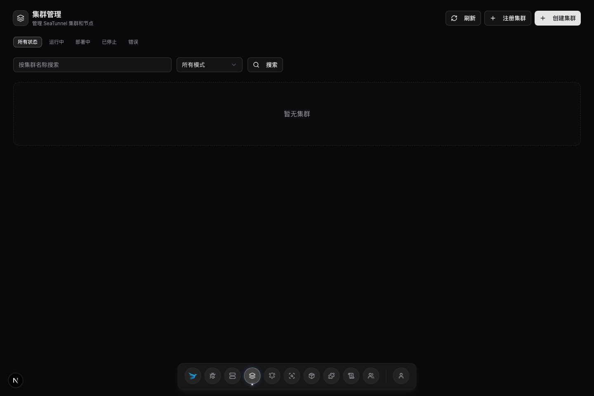

Open **Cluster management** in the Web UI. The list can be filtered by running, deploying, or stopped; cards show deployment mode, node count, and version. You can open details or stop a cluster.

[Connect a host](./host-management) and verify that stx-agent is online. Choose **Register Cluster** to manage existing SeaTunnel processes, or **Create Cluster** to install SeaTunnel on the host.

## Choose an onboarding path

| Path | When to use | What to do next |
| :--- | :--- | :--- |
| **Adopt existing processes** | SeaTunnel is already running on the host | Create cluster and nodes, discover processes, then bind |
| **One-click install** | Install a new SeaTunnel cluster on the host | Prepare the package, select host and roles, pre-check, then install |

## Deployment mode and status

| Concept | Values / default | Description |
| :--- | :--- | :--- |
| **Deployment mode** | Hybrid / Separate | Hybrid: Master+Worker in one process; Separate: independent Master / Worker processes |
| **Node role** | Master, Worker, Master/Worker | Hybrid mode commonly uses Master/Worker |
| **Cluster status** | Created → Deploying → Running / Stopped / Abnormal | Just created shows as "Created" |
| **Node status** | Pending / Installing / Running / Stopped / Abnormal; may also show offline | Offline means stx-agent on the host for that node is not online |
| **Default ports** | Master communication `5801`, API `8080`, Worker communication `5802` | Can be overridden per node |

## Adopt existing processes

1. Go to **Cluster management** → **Register Cluster**. Enter the name and select the deployment mode and SeaTunnel version.
2. Add nodes: specify online host, role, install directory, and ports (defaults per table above).
3. Trigger discovery on the host or node (stx-agent scans local SeaTunnel processes).
4. After confirming the bind, the node should show process PID and actual install directory.

:::tip
When multiple processes run on one machine, verify role and ports carefully to avoid binding a Worker to a Master node record.
:::

## One-click install

[Package management](../packages-plugins/package-management) in the Web UI must have an install package for the target version. You can upload or download first; connectors are handled in the [Plugin marketplace](../packages-plugins/plugin-marketplace).

Click **Create Cluster**:

1. In **Basic Info**, enter the name, select the deployment mode and version, and confirm the install directory.
2. **Select Hosts** and assign their roles. Separated mode requires at least one Master and one Worker.
3. Under **Install Config**, confirm the ports and resource settings. For each node's **JDK path**, select a detected JDK, enter an absolute path such as `/usr/lib/jvm/java-11`, or leave it blank for auto-detection.

4. In **Precheck**, review the stx-agent, port, install directory, and JDK checks. The install directory does not need to exist yet, but its nearest existing parent must be writable. If the specified JDK cannot run, correct its path and rerun the checks.

5. Choose any **Plugins** you need and click **Start Deploy**. Review progress and per-node results in **Deploy**. Once deployment succeeds, verify that the cluster is **Running** in the cluster list.

In development builds, the checks use the target SeaTunnel version to determine JDK compatibility. For example, SeaTunnel 2.3.13 recommends JDK 8 or 11. SeaTunnel 3.1.0 requires at least JDK 11 and recommends JDK 11 or 17. Upgrades check against the target version.

## Version upgrade

In cluster details, open **Upgrade** (or review past runs under **Upgrade Records**). The flow has three stages: **Prepare** → **Config** → **Execute**.

### Prepare

1. Choose the **Target Version** and confirm the **Target Install Directory** (defaults can follow the version).
2. Prepare the target package in [Package management](../packages-plugins/package-management) and the required connectors in the [Plugin marketplace](../packages-plugins/plugin-marketplace). The UI prompts you to fill gaps when assets are missing.
3. Click **Run Precheck**. After it passes, continue to **Config**. If you change the target version or directory, **Rerun Precheck** first.

During upgrade, the cluster switches to the target connector JARs and incrementally applies `lib` / `plugins` dependencies from the locally prepared target plugins. Same-named base JARs that ship with the install package are kept.

### Config merge

The page title is **Configuration Difference Handling**. The system compares the current cluster config with the target version config; it **does not auto-pick** a side for conflicting lines.

| Area | Role |
| :--- | :--- |
| **Config file list** | Switch files; files with diffs show a count, others are marked as no diff |
| **Old Version Config** | What the cluster currently uses; **Use Old File** applies the whole file |
| **Merged Result** | Final config that will be applied; you can edit it directly |
| **New Version Config** | What the target version provides; **Use New File** applies the whole file |

For conflicting lines, choose **Use Old Value** / **Use New Value**. You can **Create Upgrade Plan** only after every difference is resolved.

Some files may auto-merge when there is no real conflict; you still confirm the overall result. While any item stays **Pending Choice** / **Decision Required**, the plan cannot be created.

### Execute

After creating the plan, review version, package, node targets, and steps, then **Start Execution**. On the execute page you can see:

| Panel | Description |
| :--- | :--- |
| **Completion** | Overall task progress |
| **Execution Details** | **Step Tree** or node execution status |
| **Log Panel** | Persistent logs filtered by step, level, and node |

Closing steps often include health check, availability verification, and complete. When a task finishes, reopen it from **Upgrade Records** in cluster details, or **Restart Execution** on the same plan (creates a new task; old logs remain).

:::tip Before upgrade
Savepoint or pause critical sync jobs first so you can recover positions if the upgrade fails or rolls back.
:::

## Day-to-day operations

In cluster details / node list, for the **whole cluster** or a **single node**:

| Operation | Description |
| :--- | :--- |
| **Start / Stop / Restart** | Issued through stx-agent |
| **View logs** | Pull engine logs from the node for start/stop and job issues |
| **Add node** | Single add or batch add on the same host; pre-check available before add |
| **Delete node / Delete cluster** | Check running jobs first; a host linked to cluster nodes cannot be deleted from host management |
| **Upgrade** | See **Version upgrade** above |

:::tip Before stopping a cluster
For critical sync jobs, Savepoint or pause first, then stop or rolling restart to preserve recovery position.
:::

## Boundary with host management

- **Host**: machine + whether stx-agent is connected, resource heartbeats
- **Cluster**: SeaTunnel topology and process lifecycle
- Whether a node is operable depends on both node status and whether the host is online
