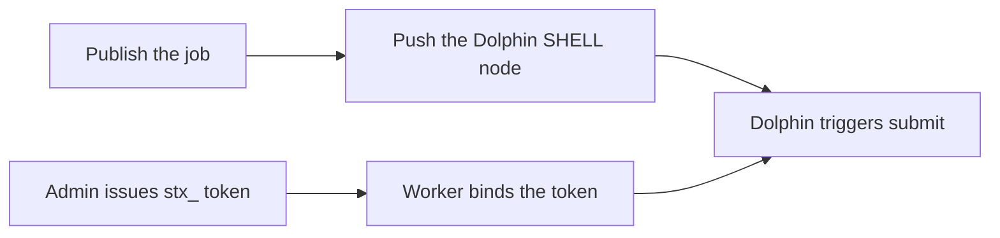

The workbench can push a published job to Apache DolphinScheduler. The Dolphin graph gets a SHELL node; when it fires, the worker runs `stx sync task submit`. Push writes that node only. It does not issue or write the worker login token.

Built-in **Schedule** stays a single-machine lightweight cron. Complex workflows, dependencies, and unified alerting live on the Dolphin graph; STX owns the script version and the submit.

## Open external schedule

In the Web UI dock, open **Workbench**, open the job, then switch the right pane to **Schedule**:


Cron and **schedule preview** are at the top; **External schedule** is below. When unbound, the hint says you can copy the SHELL script to create a node by hand, or push it to DolphinScheduler.

| State | UI |
| :--- | :--- |
| Unbound | Hint: copy the SHELL script to create a node by hand, or push it to DolphinScheduler |
| Bound | Shows the workflow / node code and "Published vN · pushed vM" |
| After bind | Built-in schedule stays off: "This task is bound to Dolphin, so the built-in schedule stays off" |

Both built-in and external schedule run the **published version** only. Unpublished edits are not scheduled.

## Publish first

If the job is unpublished, the UI says "Publish the task before pushing it to Dolphin". **Dry run** and **Push** stay disabled.

Push is allowed after a publish. The same published version cannot be pushed again; the UI says "vN is already pushed. Publish a new version before updating the node".

## Copy the script or push

| Button | What it does |
| :--- | :--- |
| **Copy node script** | Copies the SHELL body and worker reminder so you can create a node in Dolphin by hand |
| **Push to Dolphin** | Opens the push dialog; STX writes the Dolphin graph |
| **Update node** | After bind, overwrites this SHELL node only and leaves edges unchanged |
| **Open Dolphin** | Opens the Dolphin page when a console URL exists |
| **Unbind** | Removes the STX-side binding only. It does not change the Dolphin graph or revoke login tokens |

The copied script submits the current job and keeps Dolphin placeholders, for example:

```bash
exec stx sync task submit 12 --wait --confirm \
  --external-ref "ds:${system.workflow.instance.id}:${system.task.definition.code}" \
  --schedule-time "${system.datetime}" \
  --timeout 6h
```

Streaming jobs use `--wait --close-job=false --confirm` so the CLI exit does not stop the job. Default timeout is **6h**; default worker group is **default**.

The reminder says the worker environment (default name `stx-cli-prod`) must bind the STX login token itself; push does not write `STX_TOKEN`.

## Save a scheduler connection

If there is no connection yet, **Push to Dolphin** asks for an Open API URL and token before it can list projects.

| Field | Meaning |
| :--- | :--- |
| **Connection name** | A local label, for example `dolphin-prod` |
| **Open API URL** | For example `http://10.0.0.30:12345/dolphinscheduler`. The Dolphin API host must be reachable from STX; this is not the STX Web UI |
| **Dolphin Open API token** | Required, sent as the `token` header. This is **not** the worker `STX_TOKEN` |
| **Dolphin version** | Optional; empty probes automatically. Only 3.x: 3.0 / 3.1 / 3.2 use `process-definition`; 3.3+ use `workflow-definition` |

After save, the token is masked as "Open API token saved (masked)". Pick a **Scheduler connection** and **Project**, then create or reuse a workflow.


## New or reuse a workflow

| Mode | What it does |
| :--- | :--- |
| **New workflow** | Enter a **Workflow name**. Optionally **Reuse the STX built-in schedule** to copy the current cron |
| **Reuse workflow** | Pick a workflow, then **Upstream nodes** / **Downstream nodes** |

If the selected edges would cycle, the UI says "The selected edges would create a cycle, so push is blocked" and does not write Dolphin.

A later push overwrites this SHELL node only and leaves edges unchanged. The dialog can show **Current Dolphin script** and **Script that will be written**.

Use **Dry run** first ("Dry run passed; Dolphin was not changed"), then **Push**.

## Worker login token

Push does not bind the login token. The Dolphin worker must reach the STX install host API (default **17800**).

Example: STX on `10.0.0.10`, Dolphin worker on `10.0.0.30`. Issue the token on `10.0.0.10`, then bind it on the worker:

```bash
stx login --server http://10.0.0.10:17800 --token stx_...
```

Or set `STX_SERVER` and `STX_TOKEN` on the worker. Issue steps: [Token management](../architecture/token-management).



## CLI

```bash
# Binding status
stx sync task dolphin status 12

# Generate the SHELL script (does not write Dolphin)
stx sync task dolphin script 12

# Dry run / push (needs --confirm)
stx sync task dolphin push 12 --dry-run --confirm
stx sync task dolphin push 12 --new-workflow --workflow-name stx-orders --confirm

# Save a Dolphin connection
stx sync scheduler connection create --name dolphin-prod \
  --base-url http://10.0.0.30:12345/dolphinscheduler \
  --token <dolphin-open-api-token> --confirm
```

After Dolphin triggers, the job carries a `ds:` reference. The bottom job list **Mode** column shows **Dolphin schedule**, separate from manual runs and built-in cron:


Cancel by reference:

```bash
stx sync job cancel-by-ref --external-ref 'ds:123:456' --confirm
```

Writing, publishing, and built-in schedule: [Debug workbench](./overview).
