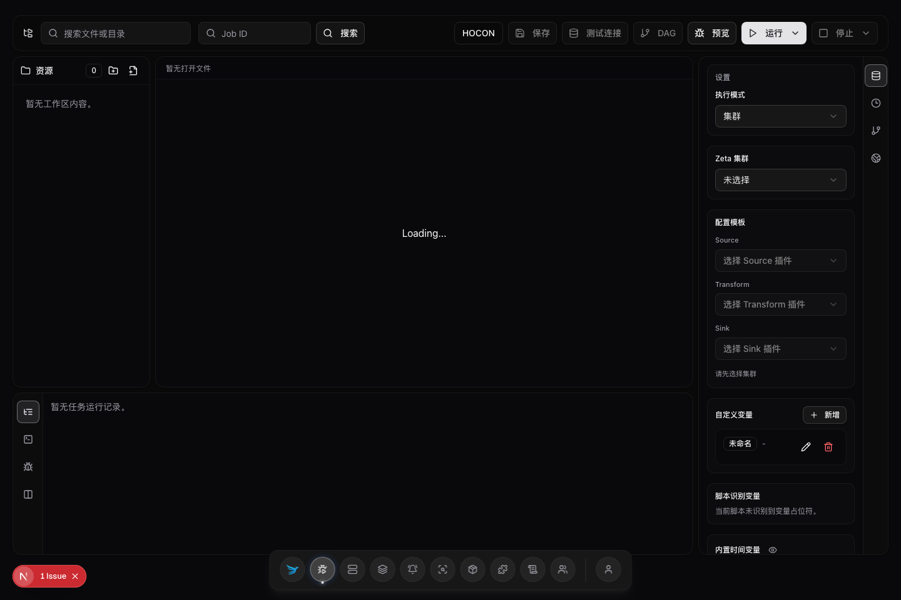
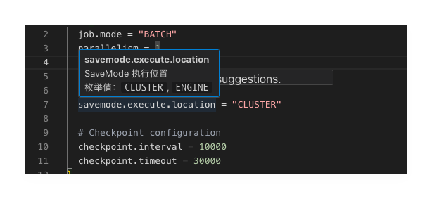
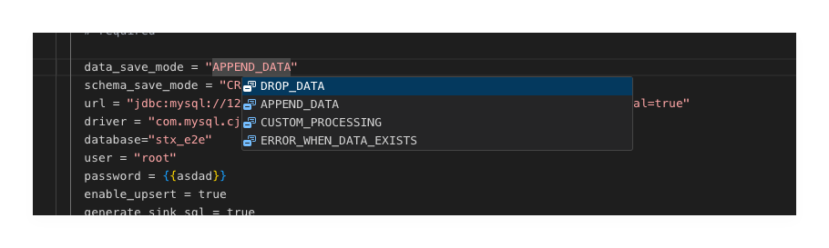
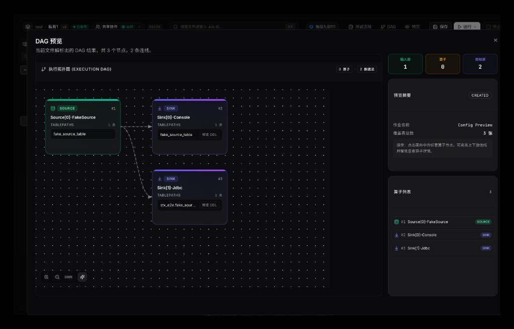
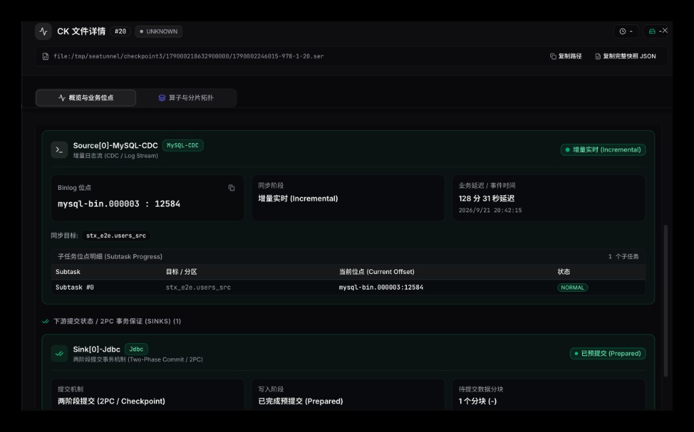

Open **Workbench** from the Web UI bottom bar. Select a cluster, then create or open a job. You can debug and run the current draft manually. Publish a version before enabling built-in scheduling or pushing to DolphinScheduler.

## Open the workbench



## Use templates

After selecting a cluster, open **Templates** on the right. There are two tabs:

| Tab | Usage |
| :--- | :--- |
| **Curated Templates** | Open by default. Filter by `env`, `source`, `transform`, `sink`, or a combination; select a template to preview it, then click **Insert**. |
| **Raw default parameter templates** | Choose a Source, Transform, or Sink plugin and insert the HOCON parameter template it provides. Switch here when you need the full raw parameters for a plugin. |


Curated templates can be combined as fragments. Select one to preview the HOCON below, then click **Insert** to write it into the editor. When you insert `env`, an existing `env` block in the script is replaced; inserting a **combined template** replaces the entire editor. If the script is not empty, you are asked to confirm first. After inserting, check sample addresses, databases, tables, paths, and credential variables before saving or publishing.

**Template management** lets you create, duplicate, edit, and delete your own curated templates. System templates are read-only; click **Duplicate** to edit your own copy. To save part of the current script, select text in the editor, right-click **Save as curated template**, then enter a name and category. Use `{{variable_name}}` for passwords or secrets—do not write them in plain text.

While editing configuration, you can use:

| Capability | Behavior |
| :--- | :--- |
| **Hover docs** | Hover over a parameter name to see its description, default value, whether it is required, and enum values |
| **Enum completion** | After `=`, valid values appear (for example `DROP_DATA` / `APPEND_DATA` / `CUSTOM_PROCESSING` / `ERROR_WHEN_DATA_EXISTS`) |

Descriptions and enum values come from the connector package on the selected cluster. To use these features, select a specific cluster. On nodes, `stx-java-proxy` listens on **18080** by default; STX Server must be able to reach it.





## Debug script

After writing configuration, use the current script to check connections, job structure, and data samples:

| Capability | What it solves | How to use |
| :--- | :--- | :--- |
| **DAG** | Hard to see script dependencies | Parses Source / Transform / Sink into nodes and edges; on the Sink side, also parses the **CREATE TABLE** statements that would run |
| **Test connection** | Verify connectivity and object existence without viewing topology | Click **Test** in the toolbar to see the result for each connection |
| **Preview** | See what real data looks like before writing Transform / Sink | Reads sample rows from Source with the current script, optionally through Transform; does not write to the configured Sink |

:::tip
DAG, connection tests, and preview use the current editor script without publishing. Save a new job once before using these tools.
:::

### DAG

See what the script does: which upstream table data comes from, how it is transformed, and where it is written downstream. Click an operator to inspect table paths and fields; on Sink nodes, compare the actual CREATE TABLE DDL.



### Test connection

After changing an address, credentials, or a table name, click **Test**. The **Test Connections** dialog shows the result for each connection without running the full job.


### Preview

Click **Preview**, confirm the row limit (default: **100**) and timeout (default: **10 minutes**), then click **Start Preview**. View sample rows from the Source or Transform in the **Preview** tab at the bottom. Preview does not write to the original Sink.


[Watch the preview steps](/img/screenshots/48-workbench-preview.webp)

## Save and publish

| Action | Effect |
| :--- | :--- |
| **Save** | Updates the draft without creating a version. Starting in v1.4.0, the workbench automatically saves the current draft shortly after you pause editing an existing job. |
| **Publish** | Confirm in the **Publish Version** dialog to save the current contents as an immutable version for history, scheduling, and CLI submissions. |

If you navigate away from the workbench within the site with unsaved edits, choose **Stay and keep editing**, **Save and leave**, or **Discard and leave**. Discarding affects only changes that have not been saved.

**Run** in the workbench uses the current editor draft; CLI submissions and built-in schedules use a published version. **Savepoint Recover** in the toolbar uses the current draft and the selected savepoint, and requires at least one published version. **Recover** from a job history row uses the original submitted configuration when available.

## Variable management

Reference variables with double curly braces in configuration, for example `{{mysql_password}}` or `{{system.biz.date}}`.

| Type | Purpose |
| :--- | :--- |
| **Built-in time variables** | Date/time expressions provided by the platform (such as business date); hover to preview the resolved value under the current baseline |
| **Custom variables** | Plain text at job level, useful for extracting database names, paths, and so on |
| **Password / secret variables** | Masked in the UI after saving; plaintext is not shown again |
| **Global variables** | Platform-level variables reused across jobs |

Use **Job variables** on the right to maintain custom variables for this job; placeholders in the script are summarized under "Variables detected in script". Do not use variable names that conflict with built-in time variables.

## Scheduling (lightweight, not production orchestration)

The workbench includes simple **scheduling** (cron). After changing schedule settings, click **Save** for them to take effect; before **Enable scheduling**, the job must have at least one **published version**. When triggered, the latest published content runs—not unsaved drafts.

This is **single-machine lightweight** periodic triggering. For complex workflows, dependencies, and unified alerting, [push the published job to DolphinScheduler](./dolphin-scheduler). Built-in and external schedule both run the published version only.

## Checkpoint and one-click recovery

When Checkpoint is enabled for a streaming job, after an abnormal or normal stop, recovering via HTTP or CLI alone means finding the job ID and passing parameters—long steps, easy to get wrong. The workbench provides:

- Toolbar **Savepoint recovery**  
- Row-level **Recover** in the bottom job list (for that historical instance)

```bash
stx sync job recover <job-id> --confirm
stx sync job cancel <job-id> --savepoint --confirm
```

The engine's built-in Checkpoint UI often shows little detail. STX parses via **stx-java-proxy** deserialization; open **CK file details** to see directly, for example:

- **Binlog position** for sources such as MySQL CDC  
- **Lag** of read progress relative to event time  
- Sink-side two-phase commit (2PC) state  
- Trigger / complete / failure counts and per-run duration waveforms  



Switch to **Checkpoint** at the bottom to open it. Streaming jobs usually need to wait for `checkpoint.interval` before the first checkpoint; **BATCH** does not trigger checkpoints by default.

## From debugging to running

1. Select an online cluster on the right.  
2. Create or open a job → insert fragments such as `MySQL-CDC` / `Jdbc` from **Curated templates**, or choose a plugin under **Raw default parameter templates**.
3. Edit parameters with hover docs and enum completion; put passwords in secret variables.  
4. **Test connection** → **DAG** to verify topology and table creation → **Preview** sample rows (you can **Save** at any time).
5. Click **Run** to execute the current draft. Publish it when you want to schedule it. For streaming jobs, view position and lag on the Checkpoint page.

New jobs default to a `FakeSource` → `Console` skeleton so you can practice editing and preview. You can also [install a cluster in one click](../host-cluster/cluster-management) for integration testing. If a connector JAR is missing on the cluster, download and install it from the [Plugin Marketplace](../packages-plugins/plugin-marketplace).

For CLI usage, see [CLI design](../architecture/cli). For cluster onboarding, see [Cluster management](../host-cluster/cluster-management).
